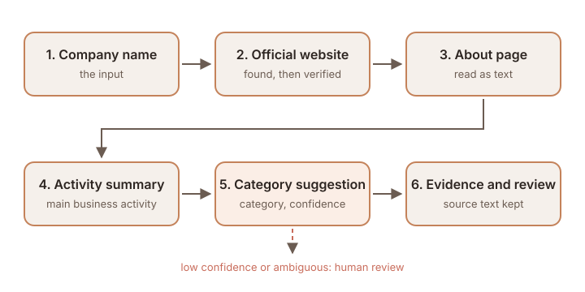

# Practice project: the Company Enricher

**From AI-written script to software you trust.**
An AI assistant wrote the first version of this service: a working script with names like `run`, `xs`, and `t`.
Every day of the course improves it.



## What the service does

1. Receive a company name.
2. Find the company's official website.
3. Read the website's About page.
4. Summarise the business's main activity.
5. Suggest one category from the category list below.
6. Keep the evidence, source page, confidence score, and review status.

The output is a suggestion because public website text may be incomplete or ambiguous.
The service must retain evidence and send uncertain cases to human review.

## Category list

This is the only place the course defines its categories.
Lessons and quizzes refer to this list rather than repeating it.

| Category | Typical About-page evidence |
|---|---|
| Retail | Sells goods to the public in shops or online |
| Wholesale & Distribution | Supplies goods in bulk to other businesses |
| Manufacturing | Makes or processes physical products |
| Software & IT | Builds software or provides IT services |
| Healthcare | Provides medical, dental, or care services |
| Food & Hospitality | Runs cafes, restaurants, catering, or accommodation |
| Construction | Builds, renovates, or maintains buildings and sites |
| Finance | Provides banking, lending, insurance, or accounting |
| Education | Teaches, trains, or runs courses |
| Other | None of the above fits with enough confidence |

## Example companies

All example companies are made up, such as **Lantern Lane Bakery**.
Some sit between two categories on purpose: a bakery that sells wholesale bread could be Manufacturing or Food & Hospitality, which is why the confidence score and review status matter.

## Ground rules

- Use made-up example companies and public sample data only.
- Never use employer data, real customer records, internal code, decision rules, or internal processes.
- The service is a practice vehicle, not the course identity.
- APIs, scraping, storage, queues, and deployment appear only when they create a useful software-design decision.
- A real industry taxonomy appears only as an optional exercise in Day 14, behind an adapter.

## How it grows

Each folder in `stages/` is a complete, runnable snapshot of the service at the end of a module, with its own tests.
Lessons quote these files directly, and `scripts/check_course.py` fails if a quote drifts from its file.

| Stage | Story | What the service gains | Lessons |
|---|---|---|---|
| `00-inherited` | The AI-written script | Works on the sample data; nobody can say why | Day 1 |
| `01-read-code` | Inherit it | Readable names, a stated promise, the same decisions | Days 1-3 |
| `02-control-complexity` | Tame its complexity | Category knowledge in one place, a deep website module, a result type, a tracer bullet | Days 4-7 |
| `03-change-safely` | Change it safely | Designed failures, an HTTP adapter with a timeout, an injectable clock, 220 tests | Days 8-11 |
| `04-model-the-domain` | Model the business | Domain language, value objects, an entity, a policy, a partner-directory translation, a core/adapters split | Days 12-15 |
| `05-design-data` | Design data that evolves | Quality targets, SQLite storage, an index, migrations, a uniqueness invariant | Days 16-20 |
| `06-operate` | Operate it | Structured logs, metrics and an alert, settings and a feature flag, caching, retries, idempotent saves | Days 21-24 |

## Run it

Python 3.10 or later, with pytest:

```bash
pip install pytest
./run_all_tests.sh                     # every stage's tests
cd stages/06-operate
python -m enricher                     # one batch over the sample companies
python -m enricher.benchmark           # Day 23's benchmark
```

Some stages hold an `exercises/` folder: deliberate "before" versions that a lesson compares with the real code.
