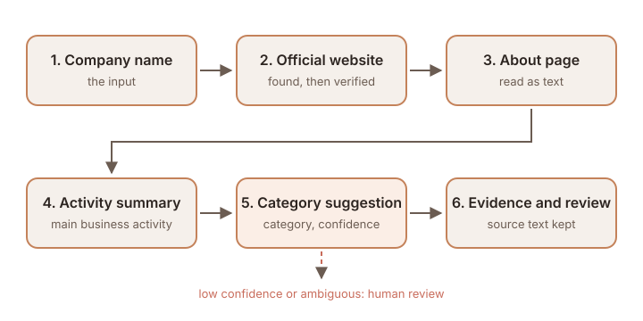

# Day 1: Use names that explain the job

[Course Home](../README.md) | [Next: Day 2 Know what a function promises →](./day-02-what-a-function-promises.md)

> 📍 **Where we are in the story:** Week 1 · You've just inherited the script. Before changing anything, you learn to read it.

---

## 🎯 Learning Objectives

By the end of today, you will be able to:

1. Rename one small Python function so you can understand its purpose without guessing.
2. Make a company-category decision visible without changing what the code does.
3. Name the thing, the stage it is at, and the choice the code makes.

**Plain idea:** a name should tell you what a value represents and why the code needs it.

**Difficulty:** 🟢 Beginner\
**Estimated Time:** 10 minutes\
**Module:** 1 · Read code before changing it (lesson 0001)

---

## 📚 Core Concepts

### Observe: meet the service

The course follows one service, the Company Enricher. An AI assistant wrote its first version; it works, and now you maintain it.

1. Start with a company name.
2. Find the official website.
3. Read the About page.
4. Summarise the business's main activity.
5. Suggest a business category from a short, plain list, with evidence and confidence.



This lesson starts near the end of that flow.
The service has About-page text and must decide which category suggestions are confident enough to return.

### Say it plainly: why short names create work

Look at `xs`, `m`, `r`, and `t`.
Python can run them, but a person must reconstruct their meaning.

A clearer name may be longer to type once, but it saves guessing every time the code is read, tested, or changed.

| | Rule | Example |
|---|---|---|
| **01 · THING** | Name the thing | Say `about_page_texts`, not `xs` or `data`. |
| **02 · STAGE** | Name where it is | Say whether a website is a candidate, verified, scraped, or classified. |
| **03 · DECISION** | Name the choice | Say `select`, `reject`, or `suggest`, not merely `run`. |

### Name it: what a good name answers

The second version in the code examples below tells you that About-page text enters, a category classifier produces probabilities, and a confidence rule selects a result.

*The Pragmatic Programmer*'s Topic 44, "Naming Things", gives the same advice from the practice side.
Its Tip 74 (p. 242 in the publisher's [official list of the book's tips](https://pragprog.com/tips/)) is "Name Well; Rename When Needed": when your understanding of the code changes, the names should change with it.

> **Key Insight:** A useful name removes a question from the next reader's mind.

### Quick reference: five questions

Choose names that answer the next reader's questions before they need a comment or debugger.

| Ask | Unclear | Clearer |
|---|---|---|
| What real thing is this? | `data` | `about_page_text` |
| Where is it in the process? | `website` | `verified_company_website` |
| What does the number measure? | `score` | `classification_confidence` |
| What choice does this function make? | `process()` | `suggest_company_category()` |
| Who supplied the value? | `result` | `website_search_result` |

Fast review:

- Replace `run`, `handle`, and `process` with the actual job.
- Put a unit in a number's name when confusion is possible.
- Distinguish candidate, verified, scraped, summarised, suggested, and accepted data.
- Use one word for one idea throughout the service.
- Rename when your understanding improves.

---

## 🔑 Key Terminology

| Term | Definition | Source |
|------|-----------|--------|
| **Function** | A named block of code that performs a job. | Official Python vocabulary ([Python tutorial](https://docs.python.org/3/tutorial/controlflow.html#defining-functions)) |
| **Service** | A larger unit of software that other programs use through its interface. | Standard software vocabulary; Ousterhout, *A Philosophy of Software Design*, 2nd ed., Chapter 4, lists services as one form a module can take |
| **Classifier** | Something that assigns an input to a category. In this course it proposes a business category from website evidence. | Standard data and machine-learning vocabulary, specialised for this course |
| **Confidence** | A score used here to show how strongly the model supports a suggestion. | Course domain term; its exact meaning must be defined by the chosen model |
| **Category list** | The short, plain list of about ten business categories the Company Enricher can suggest, such as Retail, Manufacturing, or Software & IT. | Course domain term, defined in the [practice project](../projects/company-enricher/README.md) |
| **Category suggestion** | A proposed business category that still carries evidence and review status. | Domain language for this course |
| **Stage** | Where a value is in a sequence of work, such as candidate, verified, or classified. | Course-authored teaching word |
| **Domain** | The real business problem the software works on. | Standard software vocabulary; important in *Domain-Driven Design* |
| **Boundary** | The point where this code meets another system or responsibility. | Standard software vocabulary; this plain definition is course-authored |
| **Ubiquitous language** | Words agreed and used by one domain's experts and developers. | Eric Evans's *Domain-Driven Design* term, Chapter 2; not universal software vocabulary |

---

## 💻 Code Examples

Both functions do the same thing.
Only the names change.

### Example 1: You have to guess

*File: [`projects/company-enricher/stages/00-inherited/enricher.py`](../projects/company-enricher/stages/00-inherited/enricher.py)*

```python
def run(xs, m, t=0.82):
    r = m.predict_proba(xs)
    return [
        x for x, p in zip(xs, r)
        if max(p) >= t
    ]
```

### Example 2: The job is visible

*File: [`projects/company-enricher/stages/01-read-code/enricher.py`](../projects/company-enricher/stages/01-read-code/enricher.py)*

```python
def select_confident_category_suggestions(
    about_page_texts,
    category_classifier,
    minimum_confidence=0.82,
):
    probabilities_by_page = (
        category_classifier.predict_proba(
            about_page_texts
        )
    )
    return [
        about_text
        for about_text, probabilities
        in zip(
            about_page_texts,
            probabilities_by_page,
        )
        if max(probabilities)
        >= minimum_confidence
    ]
```

**What's happening:** About-page text enters, a category classifier produces probabilities, and a confidence rule selects a result.

---

## ✏️ Hands-On Exercises

### Exercise 1 · Check: why is `minimum_confidence` better than `t`? (⏱️ ~1 min)

<details>
<summary>Choose an answer, then open to check</summary>

- It follows a style rule. *Style is secondary. The missing meaning is the real problem.*
- **It explains the decision.** *Correct. The name tells you what the number measures and how it affects the decision.*
- It makes the code longer. *Longer names can still be vague. Length is not the goal.*
- It replaces a type hint. *A type such as float cannot tell confidence from price or temperature.*

</details>

### Exercise 2 · Change: change only the names (⏱️ ~5 min)

**Goal:** Do not change the calculation.
Rename the function and values so they reveal the About-page input, category-classifier role, confidence measure, and selection decision.

*File: [`projects/company-enricher/stages/00-inherited/enricher.py`](../projects/company-enricher/stages/00-inherited/enricher.py)*

```python
def run(xs, m, t=0.82):
    r = m.predict_proba(xs)
    return [
        x for x, p in zip(xs, r)
        if max(p) >= t
    ]
```

Five pieces of meaning are still hidden.
Your rename is done when:

- [ ] The function says that it selects or filters a result.
- [ ] The input names About-page text or company records.
- [ ] The model's category-classifier job is explicit.
- [ ] The threshold names confidence and its meaning.
- [ ] Probabilities or predictions replace `r` and `p`.

### Exercise 3 · Transfer: try it elsewhere (⏱️ ~5 min)

Find one name that makes you ask "what kind?" or "at which stage?".
Rename it before adding a comment.

---

## 📖 Curated Resources

1. **Main design reading:** John Ousterhout, *A Philosophy of Software Design*, Chapter 14, "Choosing Names."
   - 🔗 [Official book page](https://web.stanford.edu/~ouster/cgi-bin/book.php)
   - Why: the design advice behind this lesson.
2. **[PEP 8: Function and Variable Names](https://peps.python.org/pep-0008/#function-and-variable-names)**
   - Why: defines Python's lowercase naming convention. Ousterhout supplies design advice; PEP 8 supplies Python convention.
3. **Practice reading:** David Thomas and Andrew Hunt, *The Pragmatic Programmer*, 20th Anniversary Edition, Topic 44, "Naming Things".
   - 🔗 [Official tip list](https://pragprog.com/tips/)
   - Why: Tip 74, on naming well and renaming when your understanding improves.

---

## 🤔 Reflection Questions

1. **Comprehension:** What does `select_confident_category_suggestions` tell a reader that `run` does not?
2. **Application:** Which of the five quick-reference questions does the name `t` fail to answer?
3. **Personal:** Which name in code you read recently made you stop and guess?

Stop and ask whenever a word feels harder than the idea.

---

## ➡️ Next Steps

**Tomorrow:** [Day 2: Know what a function promises](./day-02-what-a-function-promises.md), before reading every line of a function, find what goes in, what may come back, what else changes, and what can fail.

**Before moving on, make sure you can:**

- [ ] Say what real thing a value represents from its name.
- [ ] Rename a function without changing its behaviour.
- [ ] Name the thing, the stage, and the decision.

[Course Home](../README.md) | [Next: Day 2 Know what a function promises →](./day-02-what-a-function-promises.md)
